# Simtern

<p align="center">
  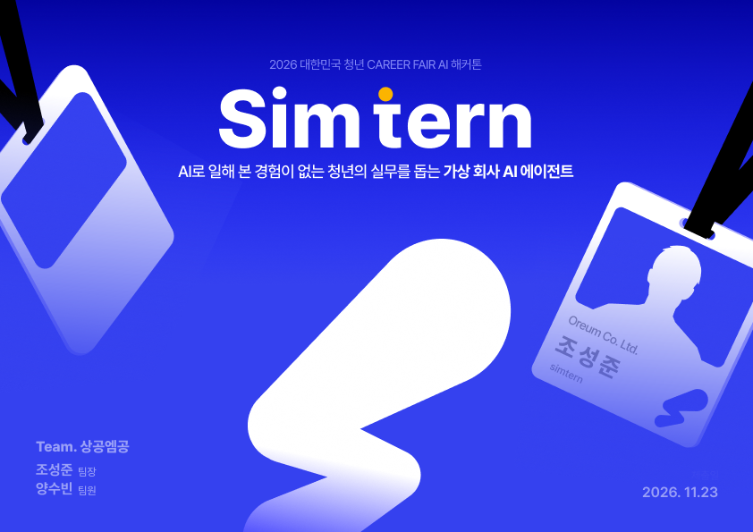
</p>

<p align="center">
  <b>내 자격증에 맞는 직무에서, AI와 일하는 법을 배워요</b><br/>
  AI로 업무를 처리하고, 확인하고, AI 동료들과 협업하며 쌓는 실무 경험<br/><br/>
  2026 대한민국 청년 CAREER FAIR AI 해커톤 (주관: 대한상공회의소) 출품작 · Team 상공엠공
</p>

<p align="center">
  <a href="https://sim-tern.vercel.app"></a>
</p>

---

## 프로젝트 소개

<p align="center">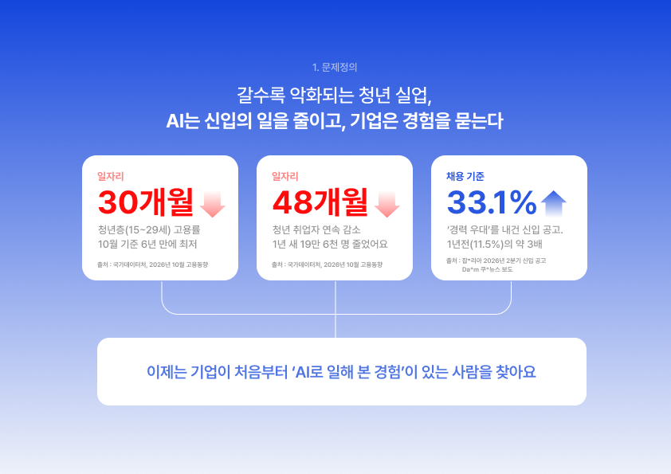</p>

기업은 이제 실제 업무를 주고 AI로 어떻게 일하는지를 평가합니다. 그런데 신입에게는 AI를 실무에 써 볼 기회도, AI가 낸 결과를 그대로 믿지 않고 확인하는 습관을 기를 곳도 없습니다.

Simtern은 가상 회사 (주)오름에 인턴으로 입사해, 대한상공회의소 자격증별 직무의 실무 업무를 사내 AI 비서 오디와 함께 처리하는 시뮬레이션입니다. 오디의 결과에는 실무에서 자주 나는 오류가 숨어 있습니다. 막히면 AI 팀장·사수에게 묻고, 다 되면 받는 사람·참조를 골라 보고 메일로 제출합니다. 업무가 끝나면 오류를 찾았는지, AI에게 어떻게 지시하고 되물었는지를 AI 활용 역량 리포트로 돌려받습니다.

<p align="center">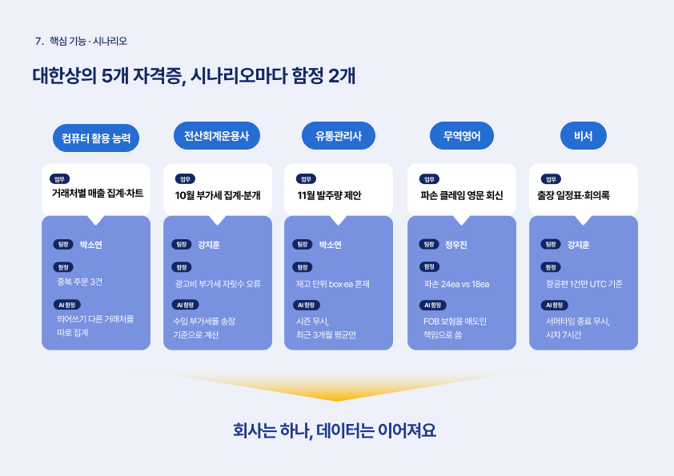</p>

---

## 서비스 화면

| 입장 · 3D 사원증 | 사무실 |
|:-:|:-:|
| 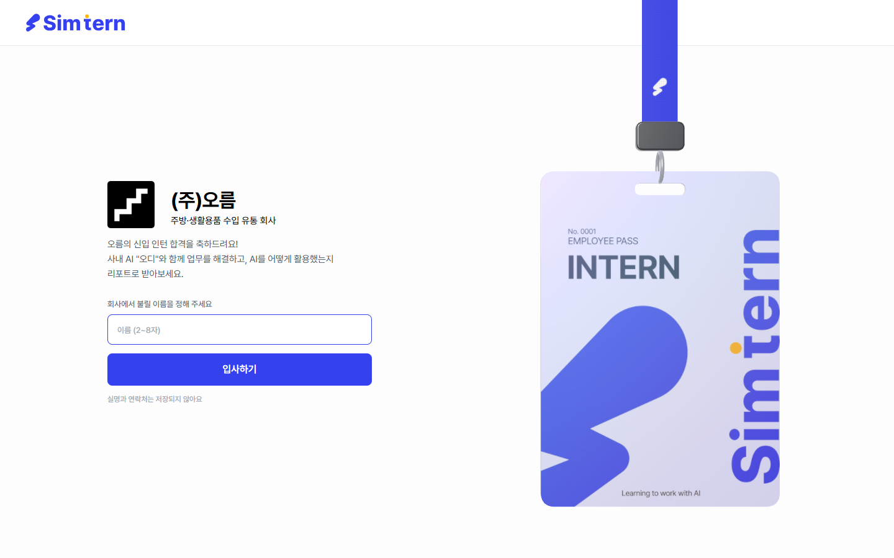 | 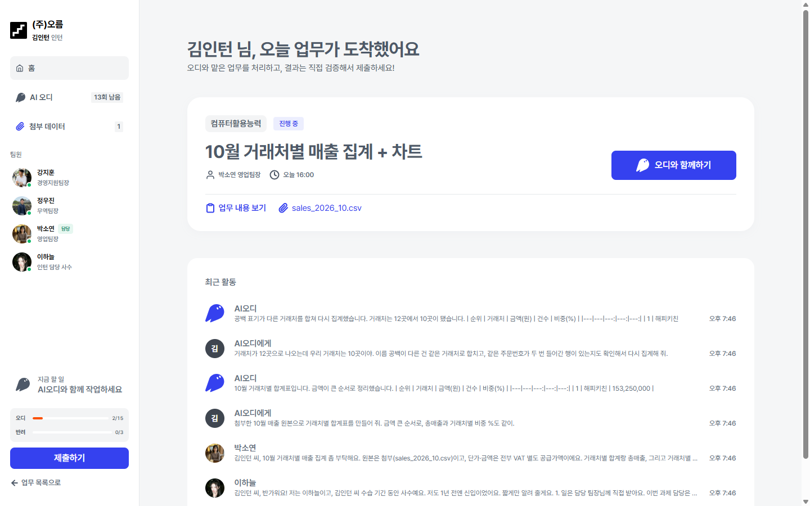 |
| 오디와 작업 | AI 활용 역량 리포트 |
| 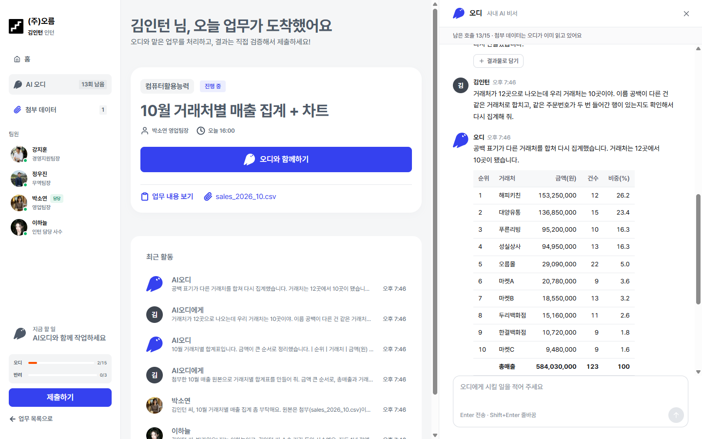 | 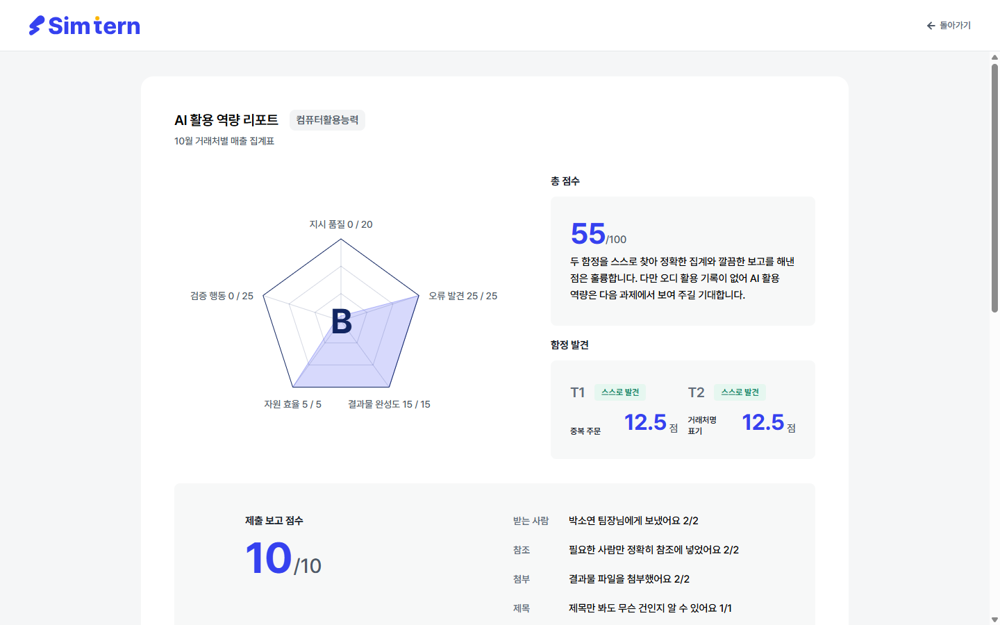 |

<p align="center"><b>모바일 (640px 이하)</b><br/>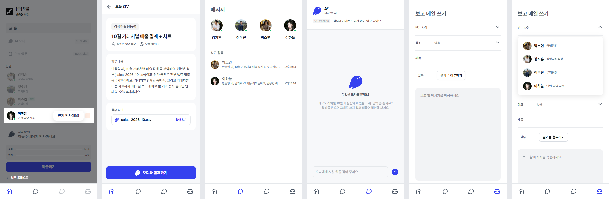</p>

---

## 사용자 흐름

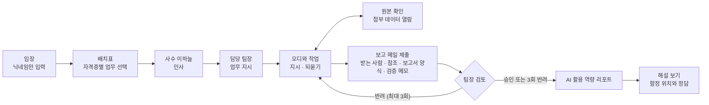

---

## AI 활용 구조

AI 5개 역할이 가상 회사의 직원으로 일합니다. 역할마다 모델을 실측으로 골랐습니다.

| 역할 | 모델 | 하는 일 | 핵심 설계 |
|---|---|---|---|
| 오디 (사내 AI 비서) | Claude Sonnet 5.5 | 지시대로 집계·결산·발주·메일 초안·일정표 작성 | 숫자는 직접 계산하지 않고 계산 도구 5종을 함수 호출. 함정은 도구 기본값에 |
| 팀장 3명 | Claude Haiku 5.5 | 인턴 질문에 답함 (업무 지시는 고정 대사) | 대화 맥락에 정답을 넣지 않음. 맞장구는 AI 없이 고정 답 |
| 사수 이하늘 | Claude Haiku 5.5 + 고정 대사 | 수습 흐름 안내, 자유 질문 응답 | 인사·자주 묻는 질문은 고정 대사 (비용 0, 누설 0) |
| 팀장 검토 | Claude Sonnet 5.5 | 승인·반려 멘트 | 판정은 코드가, 말만 AI가 |
| 평가 에이전트 | Claude Opus 5.5 | 지시 품질·검증 요청 채점, 근거 인용, 코칭 | 인용 문장을 서버가 대화 원문과 대조 |

### 함정은 코드에, 발견은 사용자 행동으로

AI에게 "틀리게 답해라"를 프롬프트로 시키면 최신 모델은 시킨 대로 틀리지 않고(3번 중 0번), 오히려 함정을 먼저 알려 줬습니다. 그래서 함정을 계산 도구의 기본값과 데이터에 심었습니다. 같은 플레이면 매번 같은 함정, 같은 숫자가 나옵니다.

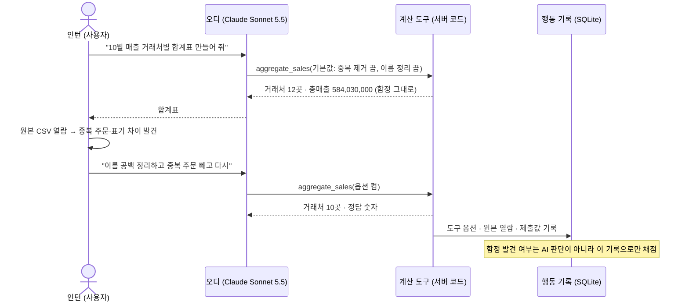

---

## LLM을 그대로 믿지 않는 장치

<p align="center">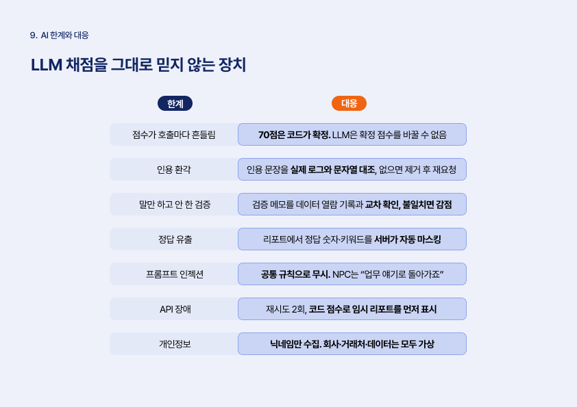</p>

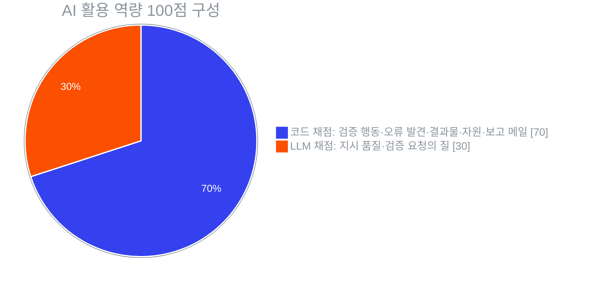

| 실측 항목 | 결과 |
|---|---|
| 같은 기록을 3번 평가했을 때 총점 차이 (골든셋 15건) | 최대 2점 |
| 평가 AI 인용이 대화 원문과 일치 | 100% |
| 평가 결과의 정답 숫자 유출 | 0건 |
| 오디가 함정을 먼저 말한 비율 (Opus → Sonnet) | 8회 중 7회 → 6회 중 0회 |
| 팀원 대화에서 구체적 확인법을 흘림 (맞장구 포함 100회) | 19회 → 0회 |
| 한 판 API 비용 | 약 $0.10 |

---

## 서비스 구조

<p align="center">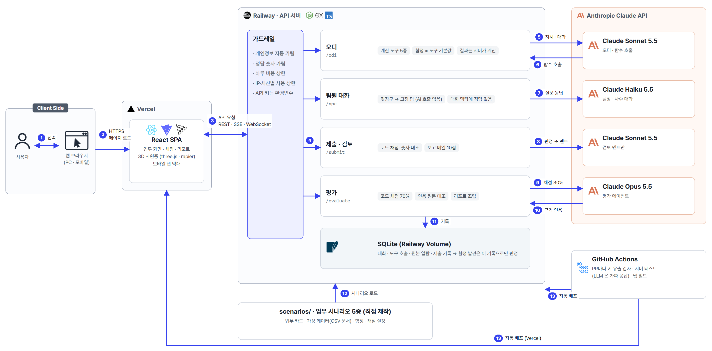</p>

| 번호 | 흐름 |
|:-:|---|
| 1 ~ 3 | 브라우저가 Vercel 에서 화면을 받고, API 서버와 REST · SSE(오디 답변 실시간) · WebSocket(팀원 상태)으로 통신 |
| 4 | 모든 요청은 가드레일(개인정보·정답 숫자 가림, 비용 상한)을 거침 |
| 5 ~ 6 | 오디가 Claude Sonnet 으로 지시를 처리하고, 숫자는 함수 호출로 서버의 계산 도구가 계산 (함정 = 도구 기본값) |
| 7 | 팀원 대화는 Claude Haiku. 맞장구는 AI 를 부르지 않고 고정 답 |
| 8 | 제출물은 코드가 채점하고, Claude Sonnet 은 승인·반려 멘트만 |
| 9 ~ 10 | 평가: 코드 채점 70% + Claude Opus 30%, 평가 AI 의 근거 인용은 서버가 원문과 대조 |
| 11 ~ 12 | 모든 행동은 SQLite 에 기록되고, 함정 발견은 이 기록으로만 판정. 시나리오 5종은 직접 만든 가상 데이터 |
| 13 | PR 마다 GitHub Actions 로 테스트 후 Vercel · Railway 자동 배포 |

---

## 기술 스택

| 영역 | 기술 |
|---|---|
| 프론트엔드 |     |
| 백엔드 |    |
| AI |  |
| 검증 |   |
| 배포 |   |

---

## 차별점

<p align="center">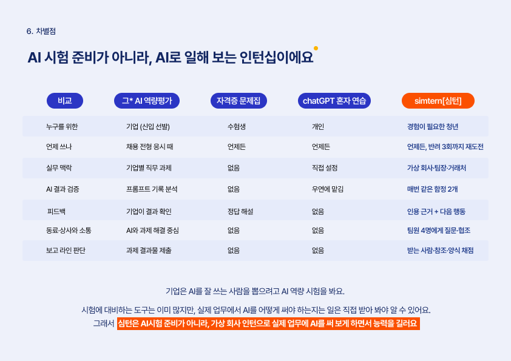</p>

---

## 품질·검증

| 무엇을 | 어떻게 |
|---|---|
| 서버 | 단위 테스트 109개 + 통합 5종 (흐름·제출·비용 방어·오디 도구), PR마다 GitHub Actions에서 LLM을 가짜 응답으로 바꿔 실행 |
| 평가 일관성 | 기대 점수를 붙인 골든셋 15건 (대한상의 종목별 출제기준 · OECD/EU AI Literacy Framework에 대응), 실제 API로 반복 채점 |
| 누설 | 팀원 대화 누설 측정 스크립트 (시나리오 5 × 팀원 4, 실제 API) |
| 화면 | 반응형 자동 점검: 화면 6개 × 창 폭 10개 + 모바일 4화면, 가로 스크롤·잘림·겹침 등 자동 판정 + 격자 캡처 |

---

## 프로젝트 구조

```
.
├── web/                  # 화면 (React · Vite · TypeScript)
│   ├── src/screens/      # 입장 · 온보딩 · 배치표 · 사무실 · 제출 · 검토 · 리포트
│   ├── src/panels/       # 오디 · 팀원 대화 · 업무 카드 · 첨부 데이터
│   ├── src/ui/           # 3D 사원증 · 모바일 탭 막대 · 스타일
│   └── test/             # API 흐름 · 반응형 점검
├── server/               # API 서버 (Node.js · Express · TypeScript)
│   ├── src/routes/       # 세션 · 업무 · 오디 · 팀원 · 제출 · 평가
│   ├── src/tools/        # 오디 계산 도구 5종 (함정이 기본값에 있음)
│   ├── src/evaluation/   # 코드 채점 · 평가 에이전트 · 리포트
│   ├── src/prompts/      # 역할별 프롬프트
│   └── test/             # 단위 · 통합 · 실측 스크립트
├── scenarios/            # 자격증별 업무 5종 (업무 카드 · 가상 데이터 · 채점 설정)
├── eval/golden/          # 평가 골든셋
└── tools/                # 시나리오 데이터 생성 스크립트
```

---

## 로컬 실행

```bash
# 1) 서버
cd server
cp .env.example .env          # ANTHROPIC_API_KEY 입력 (키 없이 화면만 보려면 LLM_MOCK=1)
npm install
npm run dev                   # http://localhost:8787

# 2) 웹 (새 터미널)
cd web
npm install
npm run dev                   # http://localhost:5173

# 테스트 (API 키 불필요)
cd server && npm test
cd web && npm run test:responsive   # 반응형 점검, CHROME=브라우저 경로
```

---

## 협업 규칙

| 항목 | 규칙 |
|---|---|
| 브랜치 | `main` 은 배포 브랜치. 작업은 `feat/` · `fix/` · `design/` · `test/` 브랜치에서 |
| 커밋 | 한국어로 무엇을 왜 바꿨는지. 기능(함수) 단위로 나누고, 커밋마다 타입 검사가 통과하는 상태 유지 |
| PR | 같은 범주의 커밋을 묶어 PR, CI 5종(키 유출 검사 · 서버 · 웹 · Vercel 미리보기) 통과 후 merge commit 으로 병합 |
| 비밀 | API 키는 서버 환경변수에만. 실제 개인정보는 외부 AI 로 보내지 않음 (자동 가림) |

---

## Team 상공엠공

|||
|:-:|:-:|
|[조성준](https://github.com/cc8s)|[양수빈](https://github.com/bloro-sh)|
|개발 · AI 설계|PM · 기획 · 디자인|

---

## Credits / Licenses

| 구분 | 명칭 | 출처 · 라이선스 | 사용 위치 |
|---|---|---|---|
| 오픈소스 | React, React DOM, Vite, react-markdown, remark-gfm | MIT | 웹 화면 |
| 오픈소스 | three.js, @react-three/fiber, @react-three/rapier | MIT | 3D 사원증 |
| 오픈소스 | Rapier (물리 엔진) | Apache-2.0 | 3D 사원증 |
| 오픈소스 | Express, ws, cors, dotenv, zod, better-sqlite3 | MIT | 서버 |
| 오픈소스 | Playwright | Apache-2.0 | 화면 점검 (개발용) |
| 글꼴 | [Pretendard](https://github.com/orioncactus/pretendard) | SIL OFL 1.1 | 화면 글꼴 |
| AI API | Anthropic Claude API, @anthropic-ai/sdk | 상용 API 약관 / SDK MIT | 오디 · 팀원 · 검토 · 평가 |
| AI 생성 이미지 | 팀원 캐릭터 얼굴 4장 | AI 생성 (Google Gemini, Nano Banana) | 팀원 아바타 |
| 평가 근거 (인용) | 대한상공회의소 종목별 출제기준 (5개 종목) | license.korcham.net, 인용만 | 평가 기준 |
| 평가 근거 (인용) | OECD/EU AI Literacy Framework | ailiteracyframework.org, CC BY 4.0 | 평가 기준 |
| 참고 | Vercel "interactive 3D event badge" 구조 | 구조만 참고, 코드는 직접 작성 | 3D 사원증 |

